# Cryptocurrency - A Small View Into the World of Ethereum ("ETH")

This repository offers a brief tour of the Ethereum ecosystem using Python-based analysis and visualization.  The notebooks and scripts gather public data, calculate common financial statistics, and display the charts below to illustrate how the network and its native currency behave.

## Project Structure

- `crypto.ipynb` – Main notebook containing data exploration and visualizations.
- `Project_1_Dashboard.ipynb` – Dashboard that combines key plots for quick viewing.
- `import_data.py` / `import_data.ipynb` – Utilities for pulling Ethereum price and network data.
- `MCForecast.py` – Monte Carlo simulation of future price scenarios.
- `Resources/` – Static images referenced throughout this README.

## Installation

Use Python 3.8+ and install the required packages:

```bash
pip install -r requirements.txt
```

## Overview and Origin of ETH

Nineteen-year-old programmer Vitalik Buterin proposed Ethereum in 2013.  The network launched in 2015 and went mainstream in 2017 when the price surged more than 1000%.  **ETH** is now the second‑largest cryptocurrency by market capitalization and introduced the idea of decentralized applications and smart contracts on a programmable blockchain.

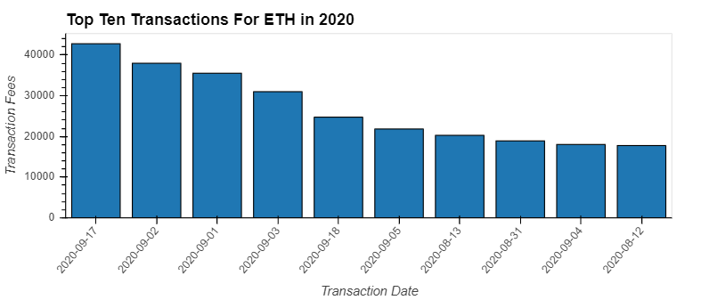

---

## What is Blockchain technology and how does it work?

Blockchain technology provides a decentralized, tamper‑resistant ledger that anyone can inspect.  Picture a spreadsheet replicated across thousands of computers that continually agree on the latest version.  That shared ledger is the foundation of Ethereum.

### The three pillars of blockchain

1. **Decentralization** – Data is stored on many devices around the world rather than in one central location, preventing any single authority from controlling the network.
2. **Transparency** – Transactions are recorded on a public ledger, making the data easy to audit and difficult to forge.
3. **Immutability** – Once data is written to the blockchain, cryptography ensures it cannot be altered without detection.

---

## Bitcoin versus Ethereum – what's the difference?

Bitcoin and Ethereum both use blockchain technology but pursue different goals:

- **Bitcoin** acts as a digital currency that people trade or hold as a store of value.
- **Ethereum** is a programmable platform that lets developers build decentralized applications, enabling broader goals such as decentralized finance (DeFi).
- A helpful analogy: Bitcoin is like iOS—tightly controlled—while Ethereum resembles Android's open‑source approach.

### Price Comparison between Bitcoin and Ethereum (past 5 years)

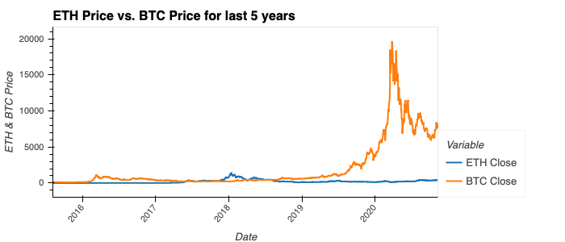

### ETH Price Compared to Different Asset Classes (past 5 years)

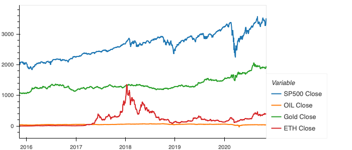

---

## Ethereum speak – the basics

### What is Ether?

- Ether is the native cryptocurrency of the Ethereum blockchain.
- It can be transferred globally, used as payment, or held as a digital asset.
- Ethereum was designed so that Ether fuels the network by paying for computation and storage.
- Unlike Bitcoin's fixed supply, ETH does not have a hard cap.

### What is GAS?

- **GAS** is the fee required to perform transactions on Ethereum and depends on the bandwidth, storage, and computational effort a transaction needs.
- GAS prices are usually quoted in **GWEI**, a tiny fraction of Ether (similar to how a penny relates to a dollar).
- Higher GAS fees incentivize miners or validators to process transactions faster.


### Comparison between Sum of Daily Transactions & ETH Price

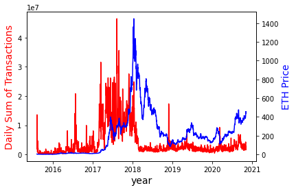

---

## Basics of an Ethereum Network

- The base layer consists of a global network of computers known as **nodes** that run Ethereum software, validate transactions, and store the ledger.
- Developers write **smart contracts** in languages such as Solidity, Vyper, or Bamboo.  These programs make transactions transparent and irreversible.
- Together, the hardware and software layers form the **Ethereum Virtual Machine**, a decentralized world computer that operates without a central authority.

---

## ETH Price Analysis

### A closer look at ETH price

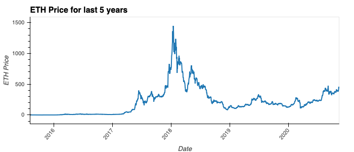

## Investment Analysis (Risks and Opportunities)

### Rolling Standard Deviation of ETH vs. Currencies & Asset Classes

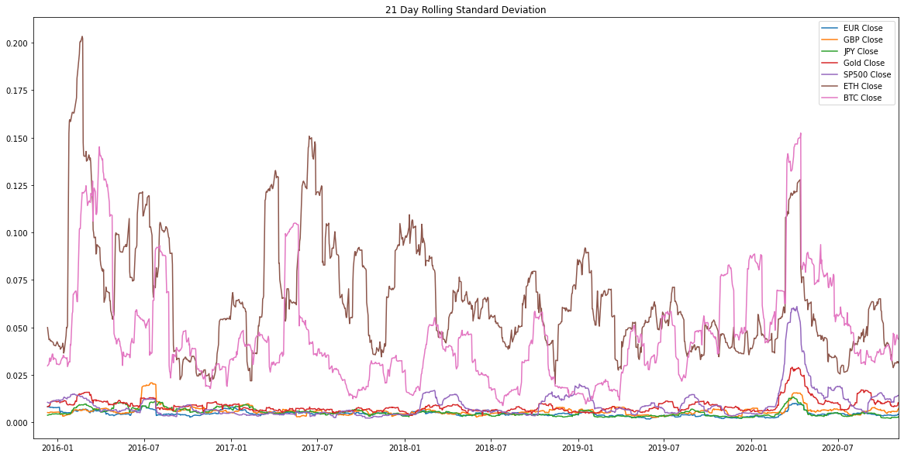

### Percentage Change of ETH vs. Currencies & Asset Classes

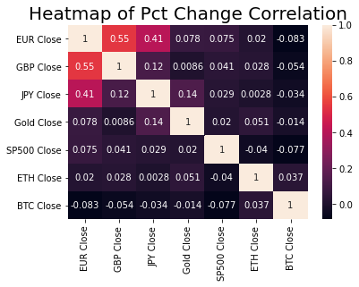

### Risk of ETH vs. Currencies & Asset Classes

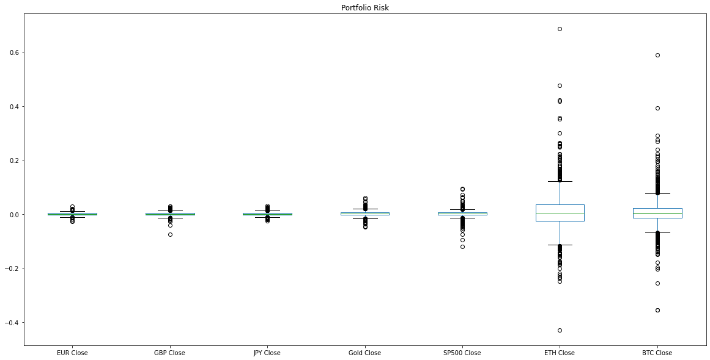

### Sharpe Ratio of ETH vs. Currencies & Asset Classes

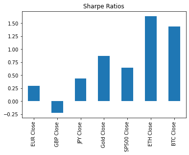

### Drawdown of ETH vs. Currencies & Asset Classes

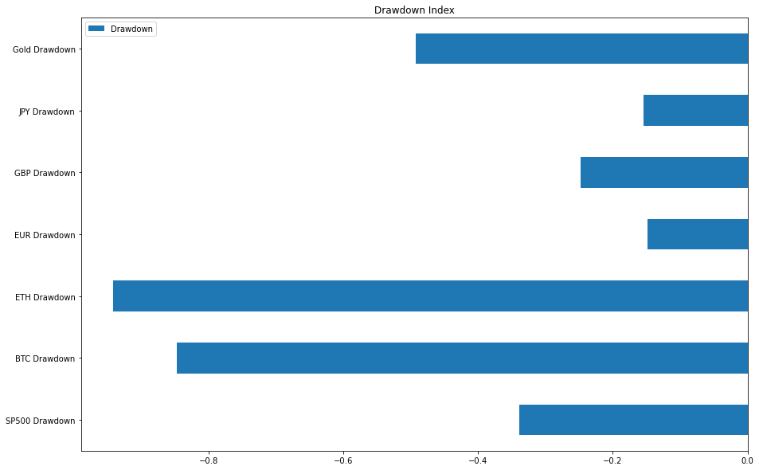

### Mining Difficulty vs. ETH Price

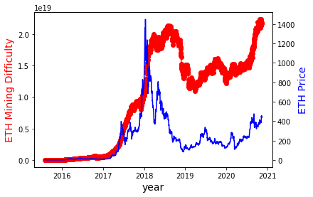

---

## Observations and Recommendations

Ethereum's price is extremely volatile yet has historically provided strong excess returns.  It can act as a hedge against traditional assets, but prudent position sizing and risk management are essential for investors.

---

## Post Mortem / Lessons Learned

- Finding reliable APIs and free data sources proved challenging, and many required extensive cleaning and date conversions.
- PyViz occasionally produced anomalies, forcing a refactor from procedural to functional code and adding development time.

---

## Works Cited

1. ETH coin image – https://www.howtogeek.com/thumbcache/2/200/832a97c90178c6a52354c0b42cea6954/wp-content/uploads/2018/04/img_5ae3b681c9ae2.jpg
2. Bitcoin Magazine – https://bitcoinmagazine.com/guides/who-created-ethereum
3. Moeller, M. (2018, February 26) *Ethereum Competitors: Guide to the Alternative Smart Contract Platforms* Blockonomi.com – https://blockonomi.com/ethereum-competitors/
4. Dughi, P. (2018, February 3) *A simple explanation of how blockchain works* Mission.org – https://medium.com/the-mission/a-simple-explanation-on-how-blockchain-works-e52f75da6e9a
5. Reiff, N. (2020, June 16) *Bitcoin vs. Ethereum: What's the Difference?* Investopedia – https://www.investopedia.com/articles/investing/031416/bitcoin-vs-ethereum-driven-different-purposes.asp
6. YouTube video – https://www.youtube.com/watch?v=DhoRtGCp4JI
7. Denominations of Ether source – https://nagritech.com/wp-content/uploads/2020/04/Screenshot-22.png
